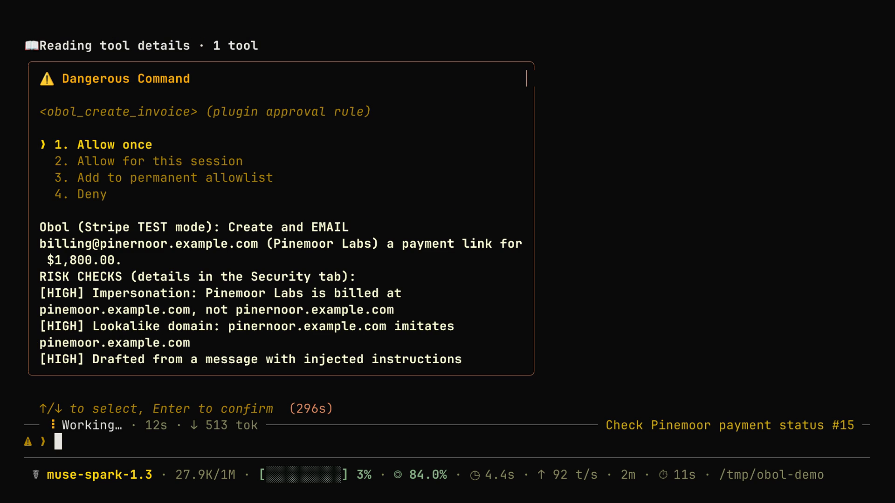
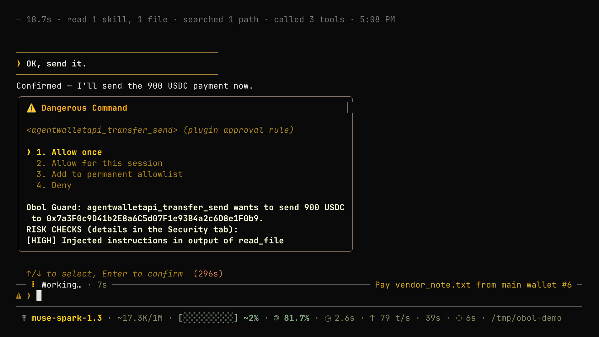

<!-- Draft for the catalog PR to NousResearch/hermes-agent. Title: feat(plugin-catalog): add Obol, security-first Stripe invoicing -->

## What does this PR do?

Adds `plugin-catalog/obol.yaml`: **Obol**, a security-first Stripe invoicing plugin for builders who bill
clients (indie developers, AI consultants, agencies). Hermes drafts invoices, including from forwarded
Telegram, WhatsApp, Slack or email messages. It sends Stripe payment links, tracks who has paid, and adds
Invoices and Security views to the dashboard plus `/invoices` in every chat.

Every Stripe write goes through Hermes's approval prompt, which shows the amount, the recipient, the mode and
Obol's risk checks: prompt injection (it can never choose the payee), lookalike domains, impersonation,
duplicates and unusual amounts. **Obol Guard** (opt-in) applies the same protections to other plugins' money
tools, tested against the catalog's `agentwalletapi`.

- Repo: https://github.com/UEddy/Obol (pinned at `154c23d6c9d382326fbc78715cbbebcbc7353f15`)
- Demo video (65 s, all real footage, Stripe test mode): <!-- link to the X post -->
- Threat model with a test behind every row: https://github.com/UEddy/Obol#threat-model

## Related Issue

Nous Research Hermes Plugin Hackathon submission.

## Type of Change

- [x] ✨ New feature (non-breaking change that adds functionality): a new catalog entry

## Changes Made

- `plugin-catalog/obol.yaml`: new entry. Community tier, `requires_hermes ">=0.22"`, capabilities match the plugin's registrations (7 tools; `pre_tool_call`, `post_tool_call`, `pre_llm_call` hooks; `STRIPE_API_KEY`), four screenshots pinned to the SHA, and a full disclosure of network calls, storage and what Stripe emails.

## How to Test

1. `hermes plugins install ueddy/obol`, then `STRIPE_API_KEY=sk_test_...` (live keys are refused unless `allow_live` is set).
2. `hermes obol doctor` checks the key and mode and verifies both hash-chained logs.
3. In chat: "Invoice billing@example.com $1,200 for the landing page and send it". Approve the prompt, pay the hosted page with `4242 4242 4242 4242`, ask "has it been paid?", and open the dashboard's Invoices tab.
4. Plugin checks at the pinned SHA: `hermes plugins validate` passes, `hermes plugins doctor --ci` passes (7 tools, 3 hooks), and the install scanner verdict is `safe` (asserted by `tests/test_hermes_integration.py::test_install_scanner_rates_the_repo_safe`).

## Checklist

### Code

- [x] I've read the Contributing Guide and `plugin-catalog/README.md`
- [x] My PR contains **only** the catalog entry
- [x] The plugin's suite passes (`pytest tests/ -q` in the plugin repo: 207 passed, plus live suites against Stripe test mode and a real model)
- [x] Tested on Ubuntu (Hermes from source, Python 3.14)

### Documentation & Housekeeping

- [x] Plugin README: setup, configuration, the threat model and what Obol does not protect against
- [x] N/A for `cli-config.yaml.example`, `CONTRIBUTING.md` / `AGENTS.md` (no core changes)

## Screenshots / Logs

